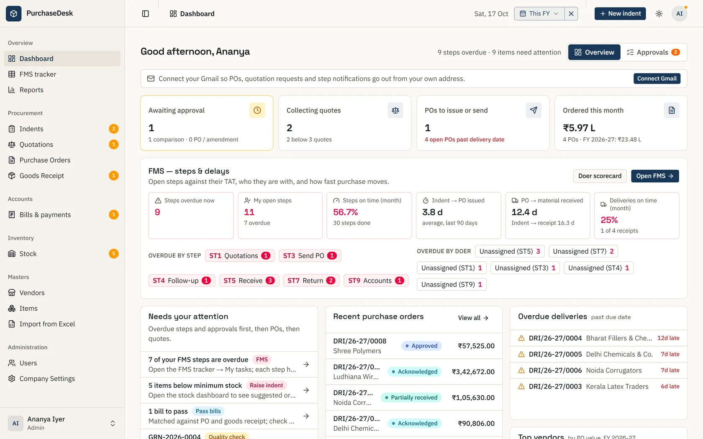

# PurchaseDesk

Purchase management for manufacturing companies (built for Indian GST): indent → quotations and
comparative statement → approval → purchase order → goods receipt and quality check → bill → payment,
with stock, vendor performance, an FMS step tracker and reports.



**Showcase site:** https://imharsh08.github.io/PurchaseDesk-public/ (features, screenshots and
diagrams; source in [`docs/`](docs/index.html)).

## Features

- **Users and roles:** Admin, Manager, Purchaser, Warehouse, Accounts (a person can hold several).
  Sign in with **email + password** (admins create users and reset passwords), or optionally with
  **Google**, limited to your domain.
- **Company settings:** letterhead, GSTIN, two logos, address book for billing / shipping, PO prefix and
  numbering (`PO-2026-0086` continuous, or `PO/2026-27/0001` reset each financial year), default terms.
- **Masters:** vendors and items with GST state codes, HSN, GST rates, units and pack sizes
  (`1 Bale = 25 Kg`); bulk import from Excel with a downloadable template and row-level errors.
- **Indents:** anyone raises a requirement (items, qty, current stock, required-by, Normal / Urgent).
- **Quotations and comparative statement:** each vendor's rates, delivery, credit, freight and attached
  quote; L1 per item and a recommended vendor scored on price, delivery, quality and payment terms
  ([QUOTATION_SCORING.md](QUOTATION_SCORING.md)), using real delivery and rejection history. Vendors can be
  chosen item by item; overriding the recommendation needs a reason. RFQ emails to vendors.
- **Approvals with limits:** each manager / admin has an approval limit (incl. GST) for comparisons, POs
  and amendments.
- **Purchase orders:** CGST + SGST or IGST picked automatically; gapless numbering; PDF generated once and
  stored; email from your own mailbox; amendments (Rev. N) with approval; cancel and short close; full
  activity trail; recommended transporter per vendor city.
- **Goods receipt (GRN):** receive in lots against a PO (invoice, challan, bilty / LR, vehicle, freight,
  attachments), then a quantity and quality check that puts accepted qty into stock. Failed checks raise
  vendor issues automatically.
- **Invoice reading:** upload or photograph an invoice on the receipt / bill screen to fill the form,
  read in the browser (PDF text or OCR); optional AI reading with a Gemini key.
- **Bills and payments:** three-way match (billed vs accepted qty, billed vs PO rate), automatic debit
  notes, pass for payment, part payments, payables ageing, MSME 45-day due dates.
- **Stock:** daily / weekly counts in packs + loose qty, minimum and re-order levels, suggested order qty,
  raise an indent from the shortfall.
- **FMS tracker:** every indent × PO through each step with planned time (TAT per step, Sundays
  skipped), actual time, delay and doer; doer scorecard; email to the next step's doers.
- **Reports** (export to Excel): spend by vendor / category / department / item / month, savings, price
  variance, vendor scorecard, PO / GRN registers, pending POs, payables ageing.
- **Dashboard:** what needs your attention, overdue steps, approvals, POs to send, receipts to check,
  bills to pass, MSME payments due, items below minimum.

## How it is built

| Part | Folder | Runs on |
|---|---|---|
| Web app (React 19 + Vite, Tailwind 4, shadcn/ui) | `web/` | Cloudflare Pages (`<name>.pages.dev`) |
| API (Hono) reusing the business code | `api/` | Neon Functions, next to the database |
| Shared business rules, screens, UI | `src/lib`, `src/components` | both of the above |
| Database (Prisma 7, PostgreSQL) | `prisma/` | Neon Postgres |
| Files (PO PDFs, logos, attachments) | | Neon Object Storage (local disk in development) |

`src/app` is also a complete Next.js 16 version of the same app (server-rendered, same database),
handy for local development or hosting on a Node server / Cloudflare Workers.

## Sign-in

- **Email + password (default):** leave `GOOGLE_CLIENT_ID` / `GOOGLE_CLIENT_SECRET` unset. The first
  admin is created by `npm run db:seed`; after that, admins add each user in **Users** with an initial
  password and can reset it there at any time.
- **Google (optional):** once the Google keys are set, "Sign in with Google" is the only way in, for
  users an admin has added. Set `ALLOWED_EMAIL_DOMAIN` to accept only your company's addresses. This also
  lets each user send POs and RFQs from their own Gmail ("Connect Gmail" in the profile menu).

## Run it locally

Requires Node.js 22 and a PostgreSQL database (a free Neon project works, or `npm run db:dev` for a local
one).

```bash
git clone https://github.com/Imharsh08/PurchaseDesk-public.git
cd PurchaseDesk-public
npm install
cp .env.example .env        # set DATABASE_URL and SESSION_SECRET
npm run db:deploy           # create the tables
npm run db:seed             # first admin (password printed once); --demo data: npm run db:seed:demo
npm run dev                 # Next.js version at http://localhost:3000
```

With `npm run db:dev`, put the connection string it prints in `DATABASE_URL` and set `DATABASE_POOL_MAX=1`.

To work on the Pages web app instead, run the API somewhere (see below) and put its address in
`web/.env.development.local` as `VITE_API_URL=...`, then `npm run web:dev` (http://localhost:5173).

## Deploy to Cloudflare Pages + Neon

You need a [Neon](https://neon.com) account (database, file storage and the API) and a
[Cloudflare](https://dash.cloudflare.com) account (the web app). Both have free plans that fit a typical
purchase team.

### 1. Database and first admin

1. Create a Neon project. Install the [Neon CLI](https://neon.com/docs/reference/neon-cli), sign in,
   and in this folder run `neon link` (it writes `DATABASE_URL` and friends to `.env`).
2. Create the tables and the first admin:

   ```bash
   npm run db:deploy
   SEED_ADMIN_EMAIL=you@yourcompany.com npm run db:seed   # prints the admin password once
   ```

### 2. API (Neon Function)

1. `neon deploy` creates the `purchasedocs` storage bucket and the `api` Function from `neon.ts`.
2. Choose your Pages address now (e.g. `https://purchasedesk-acme.pages.dev`; the name must be free on
   Cloudflare) and deploy the API with its settings:

   ```bash
   npm run api:build
   neon functions deploy api --branch production --src api/dist --no-bundle \
     --env SESSION_SECRET="$(node -e "console.log(require('crypto').randomBytes(32).toString('base64'))")" \
     --env WEB_APP_URL=https://purchasedesk-acme.pages.dev \
     --env APP_URL=https://purchasedesk-acme.pages.dev \
     --env DELETE_ADMIN_EMAILS=you@yourcompany.com
   ```

   Neon fills in `DATABASE_URL` and the storage keys by itself. Note the Function's URL it prints.
   Settings carry over between deploys, so later updates are just `npm run api:deploy`.

| API setting | |
|---|---|
| `SESSION_SECRET` | Required. 32+ random bytes; changing it signs everyone out |
| `WEB_APP_URL` | Required. Your Pages address (comma-separate several); its preview deployments are accepted too |
| `APP_URL` | Your Pages address, for links in emails |
| `DELETE_ADMIN_EMAILS` | Who may permanently delete records (with the delete password set in Settings) |
| `ALLOWED_EMAIL_DOMAIN` | Optional: only addresses on this domain can be added / sign in |
| `GOOGLE_CLIENT_ID`, `GOOGLE_CLIENT_SECRET` | Optional: Google sign-in (see below) |
| `GEMINI_API_KEY` | Optional: AI invoice reading |

### 3. Web app (Cloudflare Pages)

1. Push this repository to your GitHub account.
2. Cloudflare dashboard → **Workers & Pages** → **Create** → **Pages** → **Connect to Git**, pick the
   repository, and use the project name you chose above.
3. Build settings:

   | Setting | Value |
   |---|---|
   | Framework preset | None |
   | Build command | `npm run web:build` |
   | Build output directory | `web/dist` |
   | Environment variable | `VITE_API_URL` = the Function URL from step 2 |

4. **Save and Deploy.** Open `https://<project>.pages.dev` and sign in with the admin from step 1, then
   add your team in **Users** and fill in **Settings** (company, logo, addresses, PO numbering, FMS steps).

Every push to the main branch redeploys the web app. After pulling changes that add migrations, run
`npm run db:deploy`; after API changes, `npm run api:deploy`.

### Optional: Google sign-in and Gmail

In Google Cloud Console create an OAuth client (type *Web application*), add
`<Function URL>/auth/google/callback` as an authorised redirect URI, enable the Gmail API, and set
`GOOGLE_CLIENT_ID` / `GOOGLE_CLIENT_SECRET` (and `ALLOWED_EMAIL_DOMAIN`) on the API with
`neon functions deploy api ... --env KEY=VALUE`. Make sure every user is added in **Users** first:
password sign-in stops once Google is on.

### Alternative: the Next.js version on Cloudflare Workers

`npm run deploy` builds `src/app` with [OpenNext](https://opennext.js.org/cloudflare) and deploys it as a
Worker. Create a Hyperdrive config for your database and put its id in `wrangler.jsonc`, set the `vars`
there, and upload secrets from `.env` with `npm run cf:secrets`. Pages + Neon Functions is the
recommended setup: Workers' free plan has a 10 ms CPU limit per request that server-rendered pages exceed.

## Showcase site (GitHub Pages)

`docs/` is a static page about the app (features, screenshots taken from demo data, the
cross-functional flow and the architecture). To publish it: repository **Settings** → **Pages** →
**Source: Deploy from a branch** → branch `main`, folder `/docs` → **Save**. After a minute it is live at
https://imharsh08.github.io/PurchaseDesk-public/. In a fork, change the GitHub links in
`docs/index.html` to your repository.

## Scripts

| Script | Purpose |
|---|---|
| `npm run dev` / `build` / `start` | Next.js version: run, build, serve |
| `npm run web:dev` / `web:build` | Pages web app: run locally, build `web/dist` |
| `npm run api:build` / `api:deploy` | Bundle the API / deploy it to Neon |
| `npm test` | Unit tests (GST maths, scoring, units, FMS, invoice reading…) |
| `npm run typecheck` / `lint` | Static checks |
| `npm run db:migrate` / `db:deploy` | Migrations (create in development / apply) |
| `npm run db:seed` / `db:seed:demo` | First admin / plus a demo company, vendors, items and POs |
| `npm run db:studio` | Browse the database |

## More

- [DATABASE_SCHEMA.md](DATABASE_SCHEMA.md): the original schema design (`prisma/schema.prisma` is the source of truth)
- [QUOTATION_SCORING.md](QUOTATION_SCORING.md): how vendors are scored
- [MVP_PLAN.md](MVP_PLAN.md): the original roadmap
